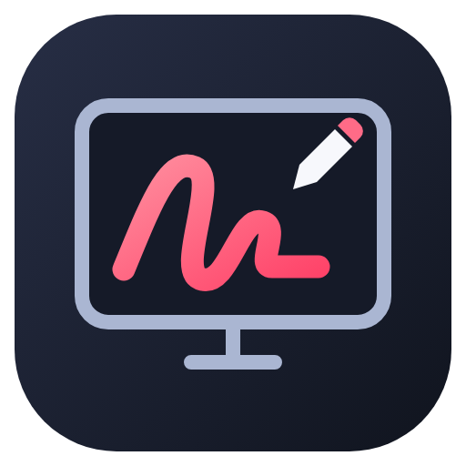

<p align="center"></p>

# ScreenBrush

Dessinez et annotez directement sur votre écran : pinceau, formes, texte, pointeur laser, projecteur et export PNG. Une application Electron indépendante inspirée de ScreenBrush.

Sur Windows, `scripts/launch-windows.ps1` installe la version préparée et crée le raccourci **ScreenBrush** sur le Bureau avec son icône.

A separate Electron desktop app inspired by ScreenBrush: transparent desktop drawing, pen, line, arrow, rectangle, ellipse, text, eraser, fading laser, spotlight, whiteboard, undo/redo, and PNG export. No original application code or assets are included.

## Run

Use Node.js 22.12 or newer. From this directory:

```sh
npm ci
npm start
```

Run on the native desktop where you want to annotate. On Windows, run these commands in Windows PowerShell with Windows Node.js; a WSL window cannot reliably cover Windows applications. macOS and Linux/X11 use the same source. Wayland compositors may restrict always-on-top overlays and global shortcuts.

From WSL, a native Windows version can be prepared with Node 22.12 or newer using `npm run build:windows`. Then run `scripts/launch-windows.ps1` in Windows PowerShell. It copies the portable app into `%LOCALAPPDATA%\ScreenBrush-Rebuild` and launches it without requiring Windows Node.js. The Windows runtime is downloaded from Electron's official releases and checked against its published checksums.

The floating toolbar has tooltips. Drag its header to move it. Ctrl/Cmd+Shift+D toggles click-through while the toolbar remains interactive. Escape also enables click-through from the canvas. Ctrl/Cmd+Shift+Q quits; Ctrl/Cmd+Z undoes; Ctrl/Cmd+Shift+Z redoes; Ctrl/Cmd+S exports drawings. Clear can be undone. The default export has transparency; whiteboard exports with its background.

## Scope and verification

This first implementation covers the primary display. It does not implement ScreenBrush Remote, snapshots library, freeze/magnification, movable objects, or pressure-sensitive strokes. See `research/findings.md` for provenance and REA limits. Native desktop overlay behavior requires verification on the target OS; a headless canvas test cannot establish it.

`npm test` checks drawing history, text anchoring, laser lifetime separation, export dispatch, and HiDPI geometry. `npm run check` validates JavaScript syntax. `npm run test:desktop` opens both Electron windows, verifies toolbar shortcuts and actual canvas pixels for drawing, clear, undo and whiteboard, then closes automatically.

The desktop check passed under WSLg. That compositor reports always-on-top as unsupported for both windows; Windows/macOS native overlay behavior has not been tested here. WSL uses software rendering to avoid observed shared-image allocation failures.

## Icon

The original editable icon is `assets/icon.svg`. PNG and Windows ICO versions are included. `npm run icons` regenerates them through Electron; the ICO contains seven resolutions from 16 to 256 pixels.
